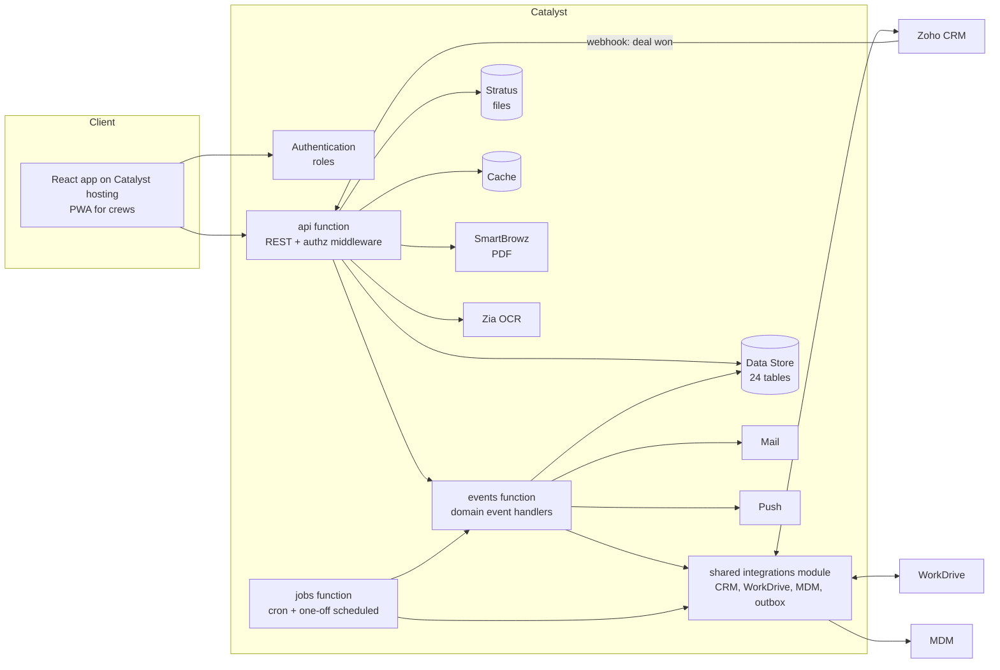

# Visual Exposure: Catalyst Resource Plan (v2, Catalyst-native)

Companion to `FSD.md` and `WORKFLOWS.md`. **This version supersedes FSD section 4 (data model).** The Creator export is a reference for *what the business does*, not a template for *how we build it*. We keep the behaviour (job flow, approvals, checklists, SWMS, compliance, hours) and redesign the structure around what Catalyst does well.

Items marked **(verify)** are Catalyst platform details I have not confirmed against current Catalyst documentation (product names, limits, exact scope strings). Confirm them in a short spike before building.

---

## 0. Why Creator needed 68 forms (and why Catalyst does not)

In Creator a **form is the only building block**. If you need a popup message, a dialog with a comment box, a child list, a calendar copy, a setting, or a place to hold a file, you create a form. Catalyst gives you a normal front end and an API, so most of those disappear.

By my classification of the 68 forms in the export, about **48 exist because of Creator's limits**, and about **20 are real business entities**:

| Group | Forms | Why Creator needed them | In Catalyst |
|---|---|---|---|
| UI message stubs | 6: Alert, Alert_Install, Alert_Install_New, Alert_Message, Awaiting_Submission3, Awaiting_Submission4 | Creator can only show a custom message or confirmation by opening a form | React modal or toast. **No table** |
| Reject, reopen and review dialogs | 11: Design/Fab/Install reject forms, Reject_Design_Tasks, Reject_Install_Form, two Reopened_Comments forms, four PM checklist forms | A dialog with a comment box has to be a form; several never store data | A modal that calls an API action. The comment is one `activity` row |
| Checklists | 11: pre, post and legacy for design, fab and install; maintenance checklists | One form per discipline per phase per role, with 80-150 columns each | One `checklist_template` (JSON) plus one `checklist` table |
| Child forms | 8: attachment subforms (3), line items, declaration, SWMS task row, equipment schedule, issue history | A list inside a record needs a child form with a lookup | `file_asset`, JSON columns, or `activity` |
| Config and masters | 9: Setup, Mail_Templates, Primary_Role_Master, equipment type, document types, ticket types, induction types, task templates, workshop locations | Settings and pick-lists have to be forms | `setting` JSON and a few small tables |
| Legacy, mirrors, imports | 3: Companies_OLD, Sheet1, Fab_and_Install_Task | Old data, a spreadsheet import, a copy of tasks so a calendar could show both | Dropped. The calendar is a query |
| **Real entities** | **20**: Jobs, Sites, Signs, Sign_Groups, Design/Fab/Install tasks, Issues, SWMS, workers, tickets, inductions, company documents, equipment, chemicals, devices, hours, timesheet, ratings, companies | | Kept (merged into the 24 tables) |

Other Creator limits that forced extra structure, all easy in Catalyst:
- **No custom UI logic:** generated HTML link fields (`View_Record`, `Edit_Record`, `Jobs_Link`) existed to build clickable links. React routes replace them.
- **Role-specific views** meant a separate report per role and stage (~200 reports). Catalyst uses one screen with filters.
- **No shared code:** the same logic was copied into dozens of near-duplicate workflows and functions. Catalyst uses one tested function.
- **Record-date schedules** needed an extra form field and a schedule per case. Catalyst has one-off scheduled jobs.
- **Per-field flags to drive the UI** (`Set_Mandatory`, `Visibility_Check`, `Internal_Stage`) were stored as data. React holds that state.

---

## 1. Design principles

1. **Model the business, not the forms.** Creator needed a form per screen and a form per checklist. A relational store with JSON columns needs far fewer tables.
2. **One table per real thing.** One `task` (design, fabrication, install), one `person` (staff and subcontractors), one `compliance_item` (tickets, inductions, company documents), one `file_asset` for every file, one `activity` log for history.
3. **Configuration is data.** Checklist questions, hazard library, compliance types, reminder offsets, notification recipients and the permission matrix live in versioned config, not in code or in per-form columns.
4. **Events, not on-validate workflows.** A state change writes the change, then publishes a domain event. Rollups, emails, CRM sync and folder creation are handlers. This replaces ~330 Creator workflow entries with a small set of idempotent handlers.
5. **Compute, don't store.** Dashboards, calendars, hours and cost are queries. Store only cached rollups the UI needs for speed, refreshed by events.
6. **Use the platform.** Stratus for files, SmartBrowz for PDFs, Zia OCR for ticket cards, Cron and Job Scheduling for timed work, Cache for config, Search, Push for crews, Signals or Event Listeners for events **(verify each)**.
7. **Fewer, role-shaped screens.** About 12 saved-view screens instead of ~200 reports.
8. **Secure by default.** Deny-by-default authorization, no secrets in code, no stored third-party passwords.

---

## 2. Summary

| Resource | Count | vs the first plan |
|---|---|---|
| Data Store tables | **24** | was 53 (Creator: 68 forms) |
| File storage | **1 Stratus bucket** with path prefixes **(verify)**, one `file_asset` table | was 10 folders |
| App roles | **11** | kept as in the first plan; to be revisited later (section 6) |
| Functions | **3** | `api`, `events`, `jobs`. Integration code is a shared module, not a separate function (section 8) |
| Domain events | **12** | section 7 |
| Scheduled jobs | **6 cron + one-off scheduled jobs** | was 9 cron; the record-date schedules become one-off jobs |
| Connectors | **2** (CRM, WorkDrive) | Writer dropped (SmartBrowz makes the PDF) |
| Other credentials | 1 (MDM, environment variables) | |
| Cache segments | **2** (`config`, `kpi`) | |
| Environments | 2 | |

---

## 3. Architecture



Flow in one line: a user action hits `api`, which validates, writes, and publishes an event. `events` handles side effects and drains the outbox. The shared integrations module (used by `events` and `jobs`) talks to Zoho CRM, WorkDrive and MDM with retry. `jobs` runs timed work.

---

## 4. Data Store: 24 tables

Conventions
- System columns Catalyst adds: `ROWID`, `CREATORID`, `CREATEDTIME`, `MODIFIEDTIME` **(verify)**.
- `legacy_id` (text) on migrated tables, removed after cut-over.
- Soft delete (`is_deleted`) on `person`, `company`, `site`, `job`, `task`, `sign`, `issue`.
- Type key: `txt`, `long`, `int`, `big`, `dec`, `bool`, `date`, `dt`, `time`, `json` (text holding JSON, validated in the API), `fk:table`.
- JSON columns are for data that is read and written as a whole and never filtered or joined. Anything we filter, sort or join on stays a real column.

### 4.1 People and organisations (4)

| # | Table | Columns |
|---|---|---|
| 1 | `person` | user_id big (Catalyst user, nullable for people who never log in), first_name, last_name, email unique, phone, company_id fk:company, kind (staff, subcontractor), job_title, roles json (mirror of Catalyst roles), tags json (optional labels, for example trades_person), hourly_rate dec (restricted), is_active, is_internal, profile json (dob, address, emergency contact: encrypted fields **(verify)**), crm_worker_id, mdm_enabled bool, is_deleted |
| 2 | `company` | name, kind (subcontractor, supplier, client, internal), contact json (owner, phone, email), state, is_active, do_not_contact json, notes, is_deleted |
| 3 | `site` | name, address json (street, suburb, state, post_code, country), lat, lng, contact json, crm_site_id, crm_account_id, crm_contact_id, is_active, is_deleted |
| 4 | `device` | person_id fk:person, serial unique, model, os, last_lat, last_lng, last_address, last_seen_at |

### 4.2 Work: jobs, signs, tasks (7)

| # | Table | Columns |
|---|---|---|
| 5 | `job` | subject, stage, pm_id fk:person, fab_manager_id fk:person, crm_deal_id unique, quote_ref, expected_finish date, agreed_fab_finish date, required_fab_finish date, workdrive_folder_id, workdrive_url, server_path, progress json (job, fab, install percent; cached), totals json (hours and labour cost by discipline; cached), flags json (closure_email_sent, profit_changed), is_deleted |
| 6 | `sign_group` | job_id fk:job, site_id fk:site, name, description, line_items json (product, qty, cost, sell, margin; synced from the CRM quote), totals json |
| 7 | `sign` | job_id fk:job, sign_group_id fk:sign_group, name, revision, qty, medium, finishing, stages json (deal, artwork, manufacturing, install), details json (artwork notes, RFQ, mock-up), install_date, crm_sign_id (CRM Assets), is_deleted |
| 8 | `task` | job_id fk:job, type (design, fabrication, install), kind (for example VE Install, Subtask, Minor, External, Print Only; fab type: CCV, CNC, CLB, Workshop, Maintenance...), name, description, stage, sub_stage, parent_id fk:task, sign_group_id fk:sign_group, site_id fk:site, pm_id fk:person, fab_manager_id fk:person, lead_id fk:person, quoted_hours dec, proposed_hours dec, booked_hours dec (cached), labour_cost dec (cached), scheduled_date date, start_at dt, finish_at dt, completed_at dt, required_finish date, repeat json (interval, unit, count), flags json (management_review, ohs, whs), swms_id fk:swms, spec json (**type-specific**: install tools, vehicles, site contact; fab CCV/CNC/CLB dimensions and materials; design type), workdrive_folder_id, workdrive_url, is_deleted |
| 9 | `task_assignee` | task_id fk:task, person_id fk:person, role (lead, member, other). Unique (task_id, person_id). Needed for "my tasks" queries |
| 10 | `task_sign` | task_id fk:task, sign_id fk:sign |
| 11 | `swms` | job_id fk:job, status (Created, PM Signed, TL Signed, Not Required), work_manager_id fk:person, pcbu json (defaults come from settings), site_address json, ppe json, tasks json (hazard rows from the library), declarations json (worker, signed_at, signature file ids), signoff json (pm and tl: who, when, signature file id), pdf_file_id fk:file_asset |

`task.spec` shapes (validated per `type` and `kind` in the API):

```json
{ "install": { "vehicles": [], "tools": { "general": [], "power": [], "safety": [], "access": [] },
               "site_contact": "", "supplied_materials": "", "install_date": "", "start_time": "" },
  "fabrication": { "ccv": { "width": 0, "height": 0, "qty": 0, "vinyl": [{ "brand": "", "colour": "" }] },
                   "cnc": { "material": "", "thickness": 0 },
                   "clb": { "material": "", "return_height": 0 } },
  "design": { "design_type": "" } }
```

### 4.3 Checklists (2)

| # | Table | Columns |
|---|---|---|
| 12 | `checklist_template` | key (for example install.pre.leader), task_type, kind, phase (pre, post), role (lead, member), version int, definition json (sections, steps, questions with type, options, required rules, issue-raising answers), is_active. New versions never edit old ones |
| 13 | `checklist` | task_id fk:task, phase (pre, post), assignee_id fk:person, role (lead, member), template_key, template_version, status (Not Completed, In Progress, Completed), steps json (briefing, arrival, onsite, closure: each with status and time), answers json (question key to value or file_asset id), started_at, finished_at, hours dec, unbilled_hours dec. Unique (task_id, assignee_id, phase) |

This replaces about 20 Creator checklist, reject, reopen and PM-review forms. Rejection, reopen and PM review are `activity` rows (section 4.5) with a payload, not tables.

### 4.4 Safety library, issues, hours, registers (5)

| # | Table | Columns |
|---|---|---|
| 14 | `hazard_library` | name, hazards, controls, ppe json, is_active. Feeds SWMS rows (replaces Task_Template) |
| 15 | `issue` | subject, description, department, status, priority, reported_by fk:person, assigned_to fk:person, owner fk:person, site_id fk:site, task_id fk:task, source (manual, checklist), crm_deal_id, completed_at, is_deleted |
| 16 | `time_entry` | person_id fk:person, work_date date, task_id fk:task (nullable), kind (design, fabrication, install, workshop, other), checklist_id fk:checklist (nullable), hours_single dec, hours_x1_5 dec, hours_x2 dec, unbilled_hours dec, labour_cost dec, source (checklist, manual), approved bool. **This is the timesheet.** Daily, weekly and pay-period views are queries; the pay-rule calculation is a tested pure function |
| 17 | `register_item` | kind (equipment, chemical), code, name, type, location_id fk:location, status, off_hire_required bool, plan json (maintenance: frequency_days, next_due, create_task, assignee, checklist items), data json (chemical: stock, unit, hazard class), is_deleted |
| 18 | `location` | name, description, supervisor_id fk:person |

### 4.5 Cross-cutting (6)

| # | Table | Columns |
|---|---|---|
| 19 | `file_asset` | entity_type, entity_id, kind (attachment, photo, signature, pdf, ticket_image, sds, artwork, document), stratus_key, name, mime, size, uploaded_by fk:person, workdrive_file_id, workdrive_url, ocr json, is_deleted. **Every file in the system is a row here.** Other tables reference ids, never file columns |
| 20 | `activity` | entity_type, entity_id, type (stage_change, comment, reject, reopen, review, field_change, notification, audit, system), actor_id fk:person, from_value, to_value, comment long, payload json, at dt. Replaces stage history, task comments, issue history, PM-review answers, notification log and audit log. Append-only |
| 21 | `compliance_type` | kind (ticket, induction, company_document), name, requires_expiry bool, reminder_offsets json (days relative to expiry, for example [30, 7, 0, -7]), mandatory bool, meta json (trainer, cost, duration, company) |
| 22 | `compliance_item` | kind, subject_type (person, company), person_id fk:person, company_id fk:company, type_id fk:compliance_type, reference, issue_date, expiry_date, is_active, do_not_contact json (worker, manager, company), meta json (training authority, sites, cost, notes), next_reminder_at dt (indexed). **No login or password fields.** Replaces company documents, tickets, inductions and the induction-site junction |
| 23 | `setting` | key unique, value json, version int, updated_by. Keys: `pay_period`, `pcbu_defaults`, `workshop_job_id`, `hours_cutoff`, `roles.assignments` (who is fab manager, installation manager, notify and inform lists by department), `notify.rules`, `authz.matrix`, `workflow.*` |
| 24 | `integration_job` | type (crm_sync, workdrive_folder, workdrive_file, mdm_sync), entity_type, entity_id, idempotency_key unique, payload json, status (pending, running, done, failed), attempts int, next_run_at dt, last_error. The **outbox** |

Plus `template` (email and PDF templates) is stored as `setting` keys of the form `template.<key>`, so it needs no table. Temporary: `migration_id_map` exists only during migration and is dropped after cut-over.

### 4.6 Indexes

| Table | Index |
|---|---|
| `task` | (job_id), (type, stage), (lead_id), (scheduled_date), (parent_id) |
| `task_assignee` | (person_id, task_id) |
| `checklist` | unique (task_id, assignee_id, phase), (assignee_id, status) |
| `job` | (stage), (pm_id), unique (crm_deal_id) |
| `time_entry` | (person_id, work_date), (task_id) |
| `compliance_item` | (next_reminder_at), (person_id), (company_id), (expiry_date) |
| `activity` | (entity_type, entity_id, at) |
| `file_asset` | (entity_type, entity_id) |
| `integration_job` | (status, next_run_at), unique (idempotency_key) |
| `issue` | (department, status) |
| Search **(verify)** | job subject, task name, person name |

### 4.7 How the 68 Creator forms map

| Creator forms | New home |
|---|---|
| Employee_Database, Primary_Role_Master, Setup (role parts) | `person`, `setting` |
| Companies1, Companies_OLD | `company` (legacy dropped) |
| Sites, Signs, Sign_Groups, Line_Items_SF | `site`, `sign`, `sign_group` (line items as JSON) |
| Jobs | `job` |
| Design_Task, Fabrication_Job1, Install_Job, Fab_and_Install_Task | `task` (calendar is a query) |
| *_Attachment_SF (3), Company document files, ticket images, SDS | `file_asset` |
| Pre/Post checklists (about 14 forms), PM checklists (4), Reject and Reopened forms (7), Awaiting_Submission3/4 | `checklist_template`, `checklist`, `activity`, API actions |
| SWMS, Declaration, Task, Task_Template | `swms`, `hazard_library` |
| Issues, Issue_Management_History | `issue`, `activity` |
| Company_Documents, Copmpany_Document_Types, Worker_Ticket_Types, Workers_Tickets, Workers_Inductions, Workers_Inductions_Type | `compliance_type`, `compliance_item` |
| Employee_Hours, Staff_Timesheet, Employee_Rating_Details, Sheet1 | `time_entry` (ratings in `activity`; Sheet1 dropped) |
| Equipment_Register(+SF), Equipment_Type, Maintenance_Checklists(+SF), Chemical_Register | `register_item` |
| Workshop_Locations | `location` |
| Devices | `device` |
| Mail_Templates | `setting` (`template.*`) |
| Alert, Alert_Install(+_New), Alert_Message | dropped (UI messages) |

---

## 5. File storage (Stratus)

One bucket, path convention `{entity_type}/{entity_id}/{file_asset_id}-{name}` **(verify Stratus vs File Store)**. Benefits over ten folders: one authorization path, one lifecycle policy, one place for virus scanning and size rules.

| Item | Plan |
|---|---|
| Upload | `api` issues a short-lived pre-signed upload URL **(verify)**; the browser uploads directly; the client confirms and `file_asset` is created |
| Download | `api` checks authorization on the owning entity, then returns a short-lived signed URL. No public objects |
| Rules | Allowed types and size per `kind`, enforced at confirm time |
| WorkDrive | Kept only as the shared job folder tree for continuity with CRM. The `events` function (using the integrations module) mirrors selected files to WorkDrive. **Decision:** keep the mirror or drop WorkDrive for files |
| OCR | Ticket card images go through Zia OCR; the extracted expiry date and reference prefill the form for confirmation **(verify)** |
| Backups | Scheduled Data Store export to a separate backup prefix **(verify)** |

---

## 6. Authentication and authorization

| Item | Plan |
|---|---|
| Sign-in | Catalyst Authentication, invite-only. Staff can use Zoho sign-in if available **(verify)**; otherwise email and password with MFA for admin and managers |
| Roles | **11** (kept; the matrix is configuration, so roles can be changed later without a schema change): `admin`, `project_manager`, `fab_manager`, `install_coordinator`, `second_ic`, `installer`, `fab_worker`, `workshop`, `designer`, `contractor`, `viewer` |
| Service access | Integrations are not a user role. They run inside the functions with connector credentials and never from the browser |
| Changing roles later | Add or rename a role in Catalyst Authentication and in `authz.matrix`. No table changes, because `person.roles` is a JSON mirror and the permission checks read the matrix |
| Task-level | Lead vs member comes from `task_assignee`, never from a role |
| Matrix | Stored as `setting authz.matrix`: role x resource x verb x scope (all, own, assigned) plus field allow and deny lists. Cached in `config`. Admin-editable, versioned, audited |
| Enforcement | One middleware in `api`: authenticate, authorize, project fields. Handlers never check roles themselves |
| Contractors | Own and assigned records only; no `person` PII |
| Default | Deny |
| Secrets | Environment variables per environment; none in the repo |

---

## 7. Domain events

State changes publish an event; handlers are idempotent (keyed by event id) and may retry.

| # | Event | Handlers |
|---|---|---|
| 1 | `job.created` (from CRM webhook) | set PM from Deal owner, create WorkDrive folder, notify Fab Manager |
| 2 | `task.created` | job to In Progress, folder job, SWMS (install), recalc progress |
| 3 | `task.assigned` | create checklists from templates, push and email to assignees |
| 4 | `task.stage_changed` | write `activity`, recalc job stage and progress, CRM sync, notifications |
| 5 | `task.submitted` | email approver, push |
| 6 | `task.reviewed` (approve, reject, reopen) | stage change, reset checklists on reject, notify assignee, closure and profit emails |
| 7 | `checklist.step_completed` | advance task sub-stage, raise an issue if an answer requires it |
| 8 | `checklist.closed` | create `time_entry`, update task hours and cost, recalc progress |
| 9 | `issue.changed` | `activity`, email by department rules |
| 10 | `swms.signed` | advance SWMS status, generate PDF when fully signed |
| 11 | `compliance.due` | email per reminder rule, advance `next_reminder_at` |
| 12 | `file.uploaded` | OCR for ticket images, mirror to WorkDrive |

The job rollup, completion percentage and labour cost are single, unit-tested functions called from handlers 4 and 8 (WORKFLOWS sections 2.1 and 10).

---

## 8. Functions and scheduled work

### 8.1 Why exactly 3 functions

Catalyst ties each function to a **trigger type**, so the number of functions follows the number of ways code is started **(verify function types)**:

| Function | Started by | Why it must be separate |
|---|---|---|
| `api` | HTTP request from the React app or the CRM webhook | Needs an HTTP (Advanced I/O) function. Latency-sensitive: users wait for it. Holds authentication, authorization and validation |
| `events` | Domain events (state changes) and the outbox queue | Needs an event-triggered function. Runs after the user has their answer, may retry, and must never slow the API. Holds the 12 handlers and drains `integration_job` |
| `jobs` | Cron and one-off scheduled jobs | Needs a cron (job) function. Time-based, no user request |

What is **not** a function:
- **Integrations (CRM, WorkDrive, MDM)** are a shared code module (`lib/integrations`) imported by `events` and `jobs`. A fourth function would add a deploy unit and a network hop without a new trigger.
- **Shared code** (authorization, rollup, completion %, pay hours, checklist progression, state machines) lives in one `lib/` package used by all three, so the rules exist once and are tested once. **(verify)** how Catalyst packages shared code across functions (monorepo build copy or an npm workspace).

**Decision: 3 functions.** One could instead run everything in `api` and let cron and events call internal routes, but that puts slow, retrying work on the user-facing path and shares one timeout and memory setting across everything. Three keeps user requests fast and failures isolated. Because the code is a modular monolith with thin entry points, this can be revisited later without a rewrite.

Cost: Catalyst bills on execution time and memory (a monthly free tier, then a per-GB-second rate, plus a per-project minimum **(verify current figures in the console)**). The number of functions does not change the bill. Keep memory small and handlers fast, and watch retry loops.

Codebase layout (one repository, shared by all three entry points):

```
functions/
  api/         entry: HTTP routes + authz middleware
  events/      entry: event handlers + outbox drain
  jobs/        entry: cron + one-off jobs
lib/           shared: domain (state machines, rollup, completion %, pay hours),
               services, integrations (CRM, WorkDrive, MDM), authz, config
```

| Function | Type | Responsibility |
|---|---|---|
| `api` | Advanced I/O (Node 22) | REST, validation, authorization, signed file URLs, PDF and OCR calls, event publishing |
| `events` | Event function **(verify)** | The 12 handlers; outbox drain with retry and dead-letter handling |
| `jobs` | Cron function | Scheduled work below |

| Scheduled job | When | What |
|---|---|---|
| `compliance-due` | daily 07:00 | Select `compliance_item` where `next_reminder_at <= now`; publish `compliance.due`. One query, one job, for tickets, inductions and company documents |
| `weekly-hours-report` | Wed 07:00 | Build the report from `time_entry`, email recipients from settings |
| `weekly-issues-report` | Thu 07:00 | One email per department manager |
| `maintenance-tasks` | daily 09:00 | `register_item.plan.next_due <= today`: create a Maintenance task, advance `next_due` |
| `profit-digest` | hourly | Send queued profit-revision digests |
| `mdm-sync` | daily (optional) | Upsert device locations |
| One-off scheduled jobs **(verify Job Scheduling)** | per record | Profit email at a stored time. Replaces Creator's record-date schedules and the two calendar-mirroring schedules (not needed) |

Time zone Australia/Melbourne; store UTC.

---

## 9. Catalyst features used, and what each replaces

| Catalyst feature **(verify availability)** | Used for | Replaces in Creator |
|---|---|---|
| Authentication + roles | Login, roles, invites | Profiles, email-based role checks |
| Data Store + ZCQL, search | 24 tables, queries, global search | 68 forms, ~200 reports |
| Stratus | All files, signed URLs | Creator file fields, file folders |
| SmartBrowz | SWMS, closure and weekly report PDFs from HTML templates | Zoho Writer merge |
| Zia OCR | Ticket card expiry prefill | Manual entry |
| Cache | Settings, permission matrix, dashboard KPIs | Repeated queries |
| Cron + Job Scheduling | 6 crons, one-off jobs | 17 schedules |
| Event listeners / Signals | Domain events | ~330 on-validate and on-success workflows |
| Catalyst Mail | All email | `sendmail` (154 uses) |
| Push notifications / PWA | Assignment and approval alerts to crews | Email only |
| Connections | CRM, WorkDrive OAuth | 4 over-scoped connections |
| CRM webhook into `api` | Job created on deal won, no polling | Manual sync functions |
| Logs and alerts | Monitoring | Debug emails to developers |
| Environments + CLI | Dev and Production, CI deploy | Single app |

Possible later: Circuits for a multi-step approval saga if the rules grow; QuickML not needed.

---

## 10. Connections

| Connection | Used for | Minimum scopes **(verify exact strings)** |
|---|---|---|
| `zoho_crm` | Read Deals, Accounts, Contacts. Update Deal job stage and cost fields, Sites, and Assets (the Sign module). Create Deal from an issue. Receive the deal-won webhook | CRM modules read and write for those modules only. No settings, users or org scopes |
| `zoho_workdrive` | Create, rename, soft-delete task folders; mirror files | WorkDrive files and folders only |
| MDM | Device locations | Environment variables: `MDM_BASE_URL`, `MDM_CLIENT_ID`, `MDM_CLIENT_SECRET` |

Rotate the leaked Creator OAuth credentials before creating any connector.

---

## 11. API (14 resource groups)

`/jobs`, `/tasks` (+ actions: submit, approve, reject, reopen, hold, release, cancel, not-used, subtask), `/checklists`, `/swms`, `/issues`, `/people`, `/companies`, `/compliance`, `/time`, `/registers`, `/files`, `/calendar`, `/dashboards`, `/admin` (settings, templates, authz, import and export, outbox). Standards: server-side filter, sort, pagination; saved views as query presets; optimistic concurrency on edits; idempotency key on action endpoints.

---

## 12. Environment variables (names only)

`APP_BASE_URL`, `MAIL_FROM`, `MDM_BASE_URL`, `MDM_CLIENT_ID`, `MDM_CLIENT_SECRET`, `CRM_ORG_ID`, `CRM_WEBHOOK_SECRET`, `LOG_LEVEL`. Everything else (workshop job, pay period, PCBU defaults, recipients, thresholds) is a `setting`. `.env.example` lists the names with empty values.

---

## 13. Concerns and risks

| # | Concern | Severity | Mitigation |
|---|---|---|---|
| 1 | Plaintext OAuth credentials in the Creator export | High | Rotate now; delete other copies |
| 2 | Business rules still ambiguous (checklist gating, completion basis, job rollup, expiry offsets) | High | Settle FSD section 14; encode as config and tested functions |
| 3 | JSON columns can drift into unvalidated data | High | JSON schema per task type, checklist template and setting key, validated on write; schema versions |
| 4 | Catalyst limits (rows per query, ZCQL joins and aggregates, function timeouts, payload and file sizes) | Medium | **(verify)** spike with 10k tasks: calendar, dashboard, rollup timings; adjust JSON versus column choices after |
| 5 | Event handlers failing or running twice | Medium | Idempotent handlers, event id, retry with backoff, dead-letter view, replay tool |
| 6 | CRM and WorkDrive failures and rate limits | Medium | Outbox with idempotency keys; admin outbox screen |
| 7 | Reports in JSON are hard to filter | Medium | Keep every filtered or sorted field a column; JSON only for read-whole data |
| 8 | Checklist template changes affecting open work | Medium | Versioned templates; a checklist keeps its `template_version` |
| 9 | Hours and cost must match Creator | Medium | Pure functions with fixtures from real Creator data; reconciliation report per job before cut-over |
| 10 | Historical data from the old wide checklists | Medium | Migrate answers into `answers` JSON by question key; archive unmapped columns as a JSON blob on the checklist |
| 11 | Mobile and poor signal on site | Medium | PWA, small payloads, draft autosave locally, retry on reconnect |
| 12 | Product names and features marked **(verify)** may differ | Medium | Day-one checklist of each feature; fallback for each (for example File Store for Stratus, `nodemailer`-style fallback unnecessary because Mail is built in) |
| 13 | Fewer tables means more logic in code | Low | Strong tests on the 6 core functions (rollup, completion, pay hours, reminder schedule, checklist progression, state machines) |
| 14 | `react-scripts` unmaintained | Low | Start the frontend on Vite |
| 15 | DST and time zone in pay hours | Low | Store UTC; test DST weeks |

---

## 14. Build plan

| Phase | Work | Output |
|---|---|---|
| 0 | Rotate credentials. Platform spike (limits, Stratus, SmartBrowz, events, OCR, push). Settle top open questions | Go/no-go, confirmed feature list |
| 1 | Repo, Vite app, `api` skeleton, auth, authz middleware, settings and cache, CI | Login and a role-checked endpoint |
| 2 | 24 tables, indexes, seed data (roles, matrix, checklist templates, hazard library, compliance types, settings) | Schema in Development |
| 3 | Jobs, people, sites, signs, CRM webhook intake | Job intake working |
| 4 | Tasks, state machines, activity log, files | Task lifecycles |
| 5 | Checklists, time entries, rollups, approvals | Core field workflow |
| 6 | SWMS with PDF, issues, notifications, push | Safety and alerts |
| 7 | Dashboards and calendars as saved-view screens | 7 role dashboards |
| 8 | Compliance with OCR, registers, scheduled jobs | Reminders and reports |
| 9 | Migration with reconciliation, UAT, security review, go-live | Live |

---

## 15. Decisions needed before Phase 2

1. Roles: keeping 11 for now; review after the first release.
2. Keep a WorkDrive file mirror, or move files fully to Stratus.
3. Which job stages remain in use.
4. Pay period start day and length; pay-rule multipliers confirmed.
5. Notification rules: who gets which email (replaces the hard-coded recipients).
6. Whether the offline-friendly PWA is in the first release.
