# Visual Exposure: Workflow Specification

Companion to `FSD.md`. Source: Zoho Creator export `Projects.ds` (app "Projects"). All diagrams are Mermaid and render in GitHub, VS Code and Miro (via the Miro plugin).

Conventions
- Stage names are the exact strings stored in Creator. They become an enum in Catalyst.
- Only **active** Creator workflows are modelled. Inactive ones are listed in FSD section 9 for client confirmation.
- Creator-only UI plumbing (popups, `openUrl`, `parent.refresh`, generated HTML link fields) is dropped and replaced by React routing.
- Items marked **[CONFIRM]** are ambiguous in the export and need a client decision (see FSD section 14).

---

## 1. System context

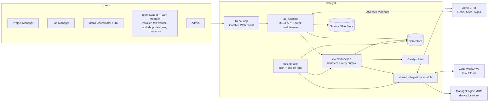

Three functions, decided: `api` answers users, `events` runs side effects and retries, `jobs` runs timed work. CRM, WorkDrive and MDM code is a shared module, not a fourth function.

---

## 2. Job lifecycle (parent record)

A Job is created only from a CRM Deal conversion. Tasks (Design, Fabrication, Install) can only be added from inside a Job.

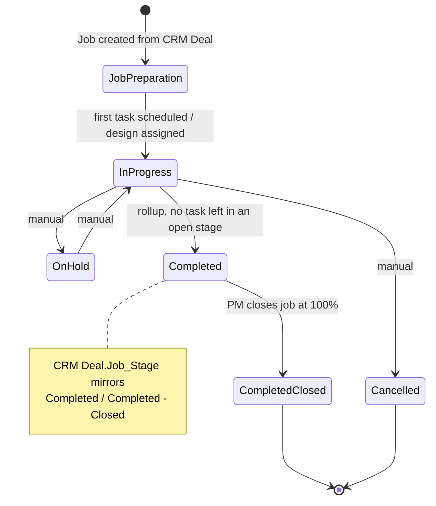

Stage values seen in reports: Preparation / Job Preparation, Design, Fabrication, Despatch, Install, In Progress, On Hold, Completed, Completed - Closed, Cancelled. **[CONFIRM]** whether Design, Fabrication, Despatch and Install are still used as job stages or are legacy.

### 2.1 Job stage rollup (`JobStageService.recalculate(jobId)`)

Runs after **every** task stage change (Creator only ran it from a few buttons, which is a gap).

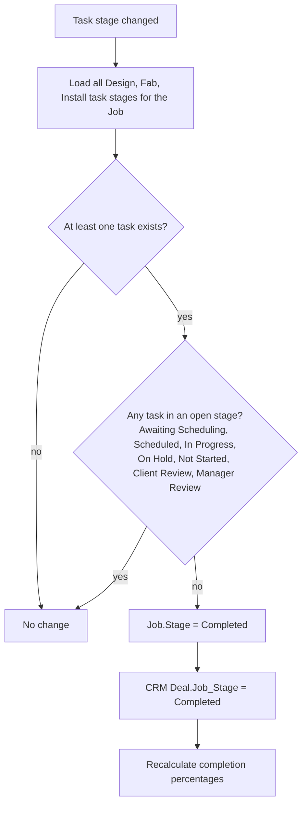

**[CONFIRM]** Pending Review, Reopen and To be Assigned do not block completion in Creator. This is probably unintended.

---

## 3. Adding tasks to a Job

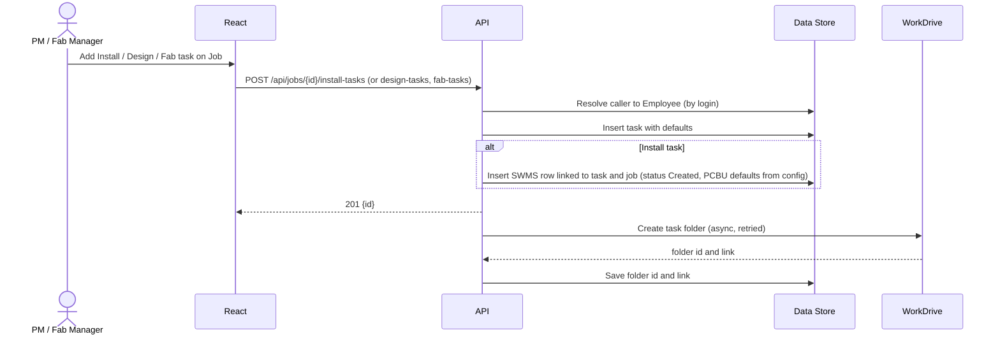

Defaults on creation

| Task | Stage | Other defaults |
|---|---|---|
| Install | Awaiting Scheduling | Install_Type = VE Install, Quoted_Hours = 0, SWMS_Status = Created, Project_Manager = caller |
| Design | To be Assigned | Quoted_Hours = 0, Cost_Type = Parent, Project_Manager = caller |
| Fabrication | Awaiting Scheduling | Quoted_Hours = 0, Fab_Manager = caller |

Do not copy the Creator leftovers: task name "New Fab Task SK", and hard-coded PCBU contact details (move to the settings table).

---

## 4. Install task

### 4.1 State machine

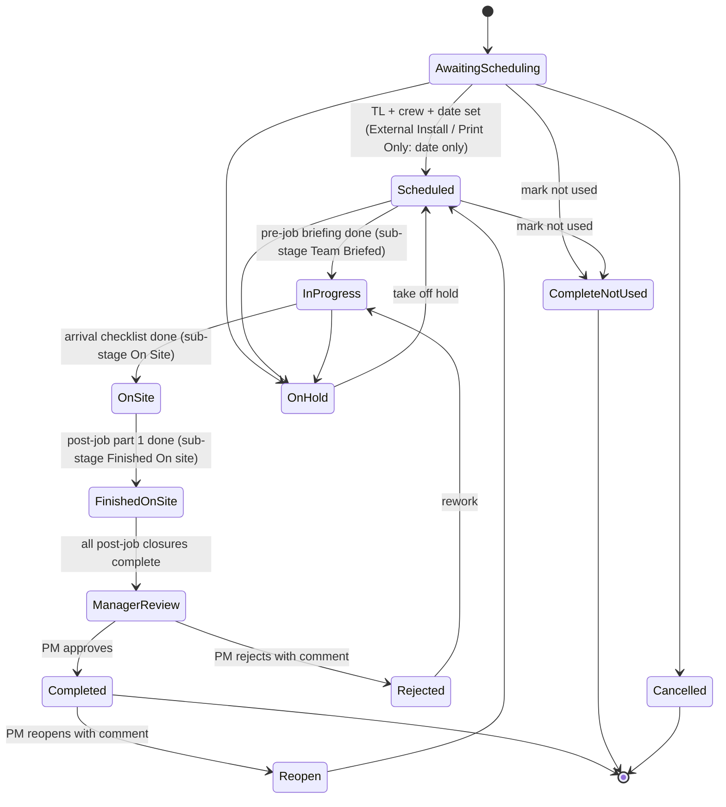

Install_Type: VE Install, VE Subtask, Minor Task, External Install, Print Only.

| Install_Type | Pre-job checklist | Post-job checklist | SWMS |
|---|---|---|---|
| VE Install | yes | yes | yes |
| VE Subtask, Minor Task | no | yes | follows parent |
| External Install, Print Only | no | no | not required; closed by PM via Close Task |

### 4.2 Checklist progression (per crew member)

Canonical rule is `Open_Checklist4`: no waiting on other crew members. **[CONFIRM]** against the older gated variant (`Open_Checklist2`), which blocked until all crew finished each step.

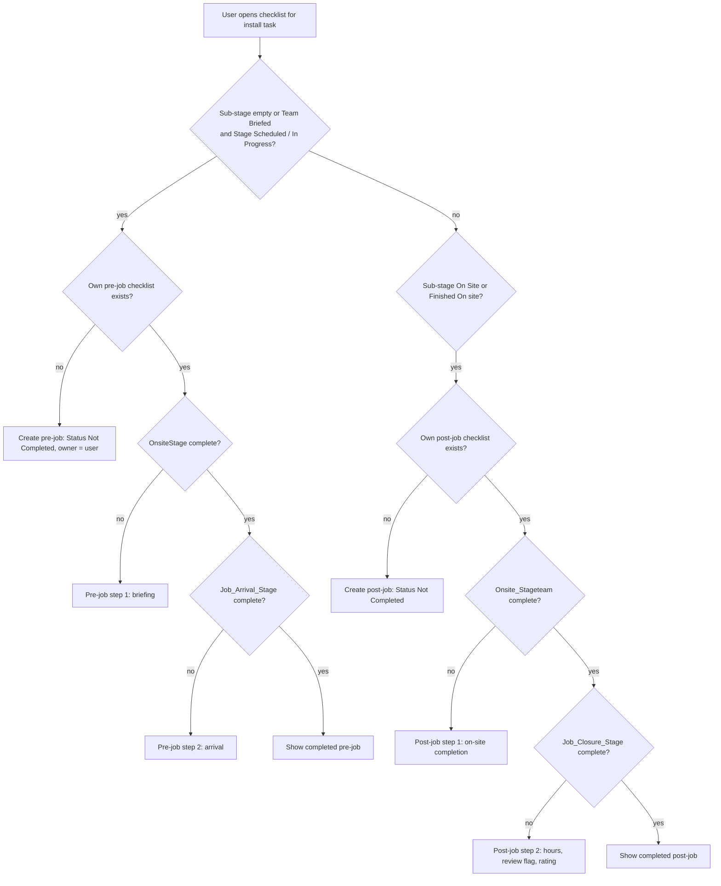

Exposed as `GET /api/install-tasks/{id}/checklist/next`. The UI renders the returned step.

Pre-job rule: the Team Leader cannot finish the pre-job checklist until the SWMS reaches the required status (see section 8).

### 4.3 Approval chain (all three task types)

```mermaid
sequenceDiagram
  actor TL as Team Leader
  actor PM as Project / Fab Manager
  participant API as API
  participant DB as Data Store
  participant MAIL as Mail
  TL->>API: POST /{type}-tasks/{id}/submit-for-approval
  API->>DB: Stage = Manager Review (install: sub-stage Finished on site)
  API->>MAIL: "Install / Fabrication / Design Task Approval" to PM (install, design) or Fab Manager (fab)
  PM->>API: GET approval form (PM checklist: comment, OH&S question default No)
  alt Approve
    PM->>API: POST /{type}-tasks/{id}/approve
    API->>DB: Stage = Completed, stamp Completed date, post hours and labour cost
    API->>DB: JobStageService.recalculate
    opt Management review or WHS flag raised
      API->>MAIL: Notify installation manager plus Setup "inform also" list
    end
  else Reject
    PM->>API: POST /{type}-tasks/{id}/reject {comment}
    API->>DB: Stage = Rejected, save comment, reset post-job checklists to Not Completed
    API->>MAIL: Notify assignee (Creator sent this to a test address; fix)
  else Reopen
    PM->>API: POST /{type}-tasks/{id}/reopen {comment}
    API->>DB: Stage = Reopen, save comment in Reopened_Comments
  end
```

Design differs in naming: its approved terminal is "Approved & Completed" and it has an extra Awaiting Submission step before Manager Review. Completing a Design task requires booked hours.

---

## 5. Fabrication task

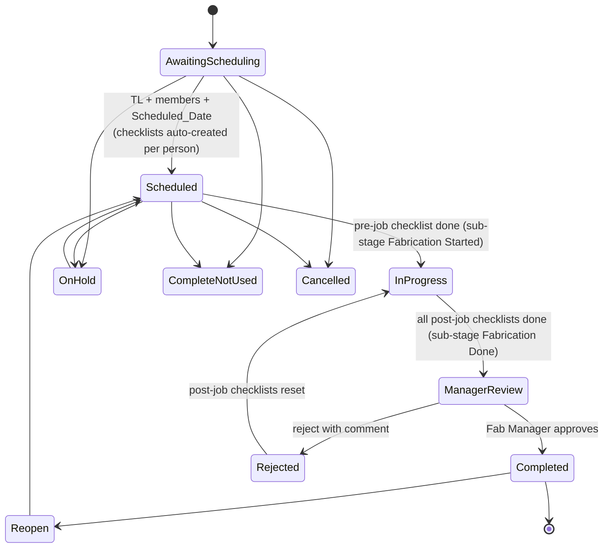

Rules
- Fab_Type values: CCV, CNC, CLB, General/Pack, Metal, Paint, Maintenance, LED, Workshop. Spec panels exist for CCV (vinyl), CNC and CLB.
- Workshop tasks skip the pre-job checklist and go straight to post-job. **[CONFIRM]** (the Creator code has a bug here).
- Parent/sub tasks: all subtasks hang off the root parent task.
- Repeating workshop task: on Complete, next Scheduled_Date = previous + Days (Weeks x 7, Months x 30).
- Maintenance type: on creation or review, equipment next-due = today + Maintenance_Frequency_Days. **[CONFIRM]** calendar vs business days (Creator uses both).
- Mark Complete - Not Used: delete TL and member checklists, clear TL and assignees, rollup.
- Cancel: Stage = Cancelled, Scheduled_Date null, assignees cleared, Quoted_Hours = 0. It does **not** delete checklists in Creator. **[CONFIRM]**.

### 5.1 Fab checklist selection

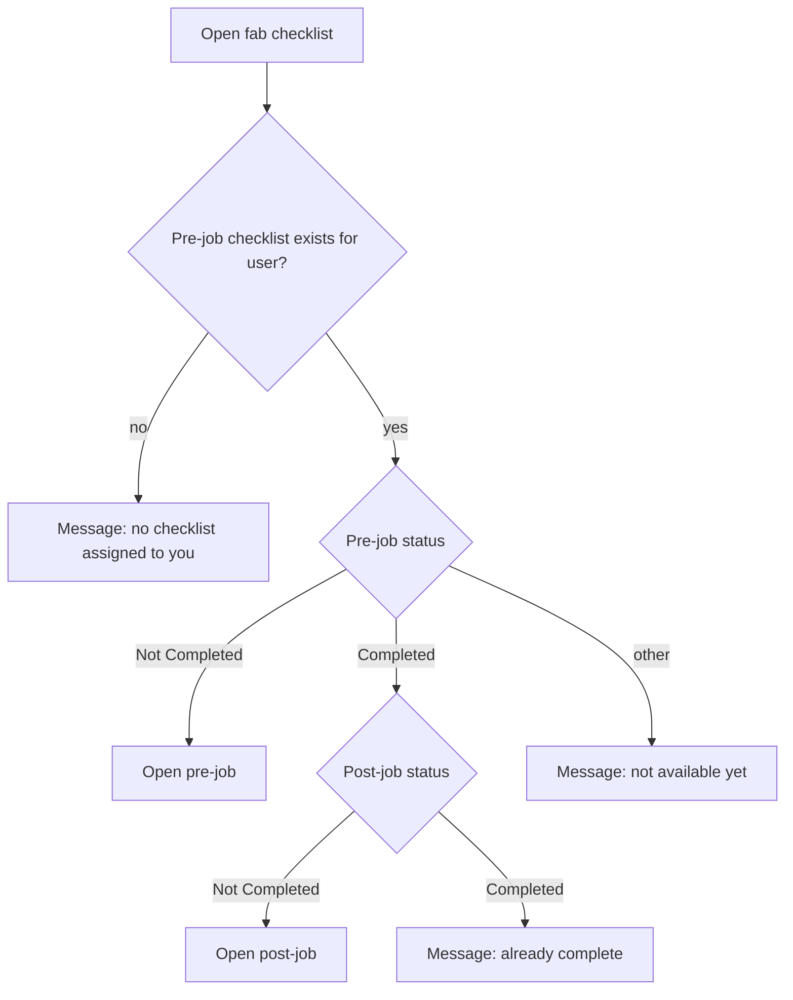

---

## 6. Design task

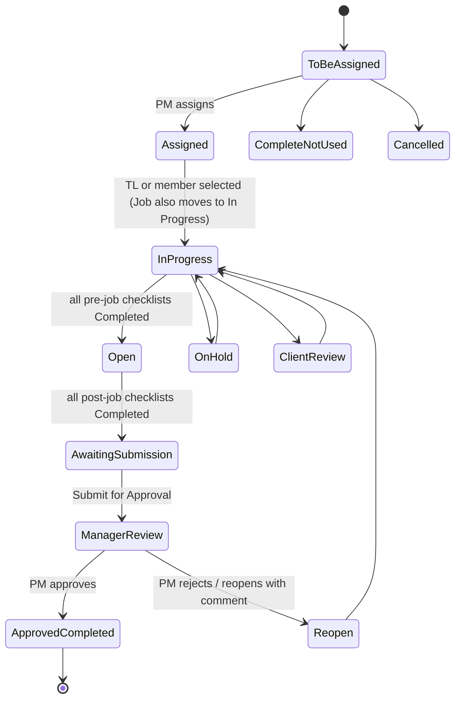

---

## 7. Subtask creation

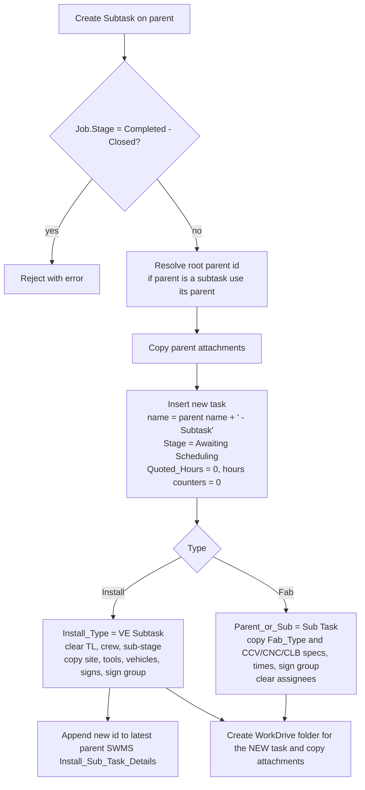

**[CONFIRM]** Creator's fab variants pass the parent id when creating the WorkDrive folder. The spec above uses the new task id.

---

## 8. SWMS (Safe Work Method Statement)

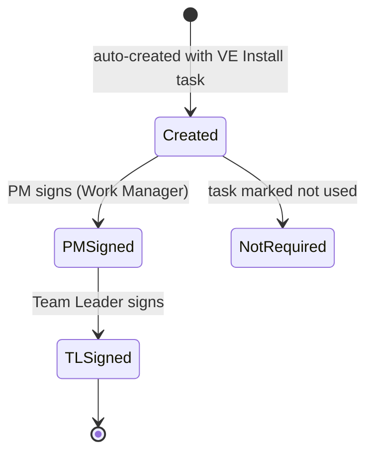

- SWMS holds signatures, PPE tick-boxes, a task table (Task rows from Task_Template) and a Declaration subform per crew member.
- PPE auto-ticking rules only add ticks, never remove them.
- A PDF is generated from the SWMS (Creator used Zoho Writer merge). Replacement: generate the PDF from an HTML template with Catalyst SmartBrowz **(verify availability)**, called from the `api` or `events` function.
- `GS_SWMS_edit_button` and `Edit_SWMS` are navigation only.

---

## 9. Issues module

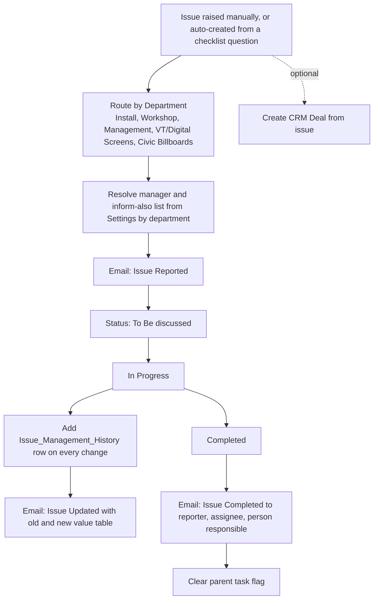

Status values: To Be discussed, In Progress, Completed (full list to be confirmed against the dropdown). Priority defaults to Low when auto-created.

---

## 10. Hours, labour cost and completion

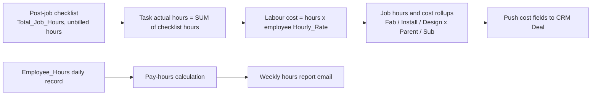

Calculations (to be implemented as unit-tested pure functions)

| Calculation | Rule |
|---|---|
| Install Total_Job_Hours | (finish - start) in decimal hours. Warn above 14 h (16 h in shift validators). Hard limit on fab post-job: 0 < hours <= 16. |
| Fab Finish_Time | Start_Time + Proposed_Hours |
| Completion % (Fab, Install, Job) | completed quoted hours / total quoted hours x 100, integer. Done set = Completed, Complete - Not Used, Manager Review, Cancelled. If total hours are 0: 100 if all tasks done, else 0. Job version includes Design. **[CONFIRM]** Proposed vs Quoted basis (Creator mixes them). |
| Repeat interval | Days = count; Weeks x 7; Months x 30 |
| Timesheet pay hours | Mon-Fri window 06:00-18:00: first 8 h single, next 2 h x1.5, rest x2. Outside window x2. Saturday: first 2 h x1.5 then x2. Sunday x2. Breaks are deducted from double first, then x1.5, then single. |
| Fab variance | Quoted - single - 1.5 x time-and-half - 2 x double |
| Profit and profit % | Not calculated in Creator. Read from CRM Deal (Job_Profit, Job_Profit1). |

Pay-period windows are computed three different ways in Creator. Replace with one pay-period configuration (**[CONFIRM]** period start day and length).

---

## 11. Scheduled jobs (run by the `jobs` function, time zone Australia/Melbourne)

| Job | Schedule | Logic |
|---|---|---|
| `compliance-due` | daily 07:00 | One job for company documents, worker tickets and inductions: select `compliance_item` rows with `next_reminder_at <= now`, publish `compliance.due`, email on the configured offsets (before, on, after expiry) to the installation manager and the company or worker; honour opt-out flags; then advance `next_reminder_at` |
| `weekly-hours-report` | Wed 07:00 | Build the booked-hours report from `time_entry`, email recipients from settings |
| `weekly-issues-report` | Thu 07:00 | One email per department manager listing open issues |
| `maintenance-tasks` | daily 09:00 | For `register_item` rows whose maintenance `next_due` is today or earlier, create a Maintenance fab task and advance `next_due` |
| `profit-digest` | hourly | Send the queued profit-revision digest for jobs whose scheduled time has passed |
| `mdm-sync` (optional) | daily | Pull device locations from the MDM system |

The Creator "weekly employee hours" job is no longer needed: daily, weekly and pay-period hours are queries over `time_entry`.

Dropped: the two one-shot "mirror to calendar" schedules (S9, S10). In Catalyst the unified calendar is a query, not a copied record. Seven inactive schedules are out of scope unless the client confirms.

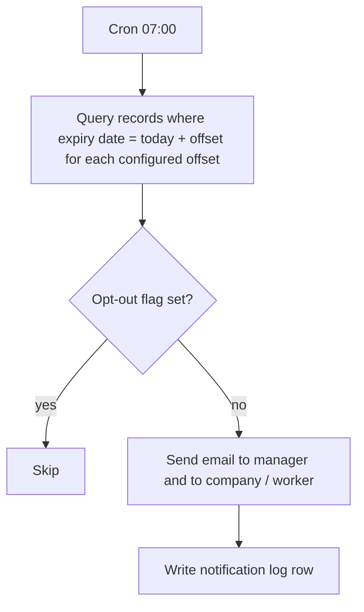

---

## 12. CRM and WorkDrive integration points

| Event | Direction | Action |
|---|---|---|
| Deal converted to Job | CRM to app | Create Job, set Project Manager from Deal owner |
| Job completed or closed | app to CRM | Deal.Job_Stage = Completed / Completed - Closed; Deal.related_Job_check = true |
| Task hours changed | app to CRM | Update Deal labour-cost fields (Design, Fab, Install; Parent and Sub split) |
| Sign edited | app to CRM | Update the CRM Assets module (the Sign module) |
| Issue "Create Deal" | app to CRM | Create Deal from issue |
| Job closure | CRM to app | Read Total_Revenue, Total_Purchases, Design_Labour_Cost, Job_Profit, Job_Profit1 for the closure email |
| Task created | app to WorkDrive | Create folder under the Deal's parent folder for that task type, named from the task; rename on name change; rename "(DELETED)" on delete |
| Attachment added or deleted | app to WorkDrive | Upload or delete file |

All integration calls run inside the `events` and `jobs` functions through the shared integrations module, with credentials from environment secrets and connectors, never in the browser. Calls go through the `integration_job` outbox with idempotency keys and retry.

---

## 13. Notifications catalogue

Sender is a configured address. Recipients are resolved by role from Settings, never hard-coded.

| Event | Recipient role | Subject pattern |
|---|---|---|
| New Job created | Fab Manager (PM mail is inactive in Creator) | Job Checklist: {job} |
| Checklist assigned (design) | Checklist owner | Design Job Checklist |
| Submit for approval | PM (install, design) or Fab Manager (fab) | {Install/Fabrication/Design} Task Approval |
| Reject | Assignee | {Type} Task is Rejected: {name} |
| Fab checklist submitted | Fab Manager | Fab Checklist Submitted: {task} - {employee} |
| Install finished on site | PM, installation manager | Install Finished On Site: {task} - {employee} |
| Equipment off hire | Equipment managers | Equipment Off Hire: {task} |
| Job closure report (once) | Directors, PM, Fab Manager | job profitability and hours tables |
| Profit changed after fab complete | PM / directors | profit-change notice |
| Issue reported / updated / completed | Department manager, reporter, inform-also list | Issue Reported / Record Updated / Issue Completed |
| Expiry reminders | Installation manager, company, worker | by document type |
| Weekly reports | Settings recipients | hours report, issues report |

Drop all debug and test mails sent to developer addresses.

---

## 14. Defects in Creator not to be copied

1. Design reject email went to a test address and its text said "Install Task".
2. `Reopened_Comments_for_Design` updated Install_Job instead of Design_Task.
3. Site Post_Code was written into the install `Country` field.
4. Completion percentages mixed Proposed and Quoted hours.
5. Report criteria such as `Stage != Completed || Stage != Cancelled` were always true. Rebuild filters with correct AND logic.
6. Checklist create and delete logic ran in on-validate (before save). In Catalyst run it after a successful save, idempotently.
7. Hard-coded cutoff date, company-name checks ("Visual Exposure" used to detect internal staff) and a fixed "Workshop" job id. Use an is-internal flag and configuration.
8. Role scoping by email comparison only. Use user id plus role claims enforced server-side on every endpoint.
